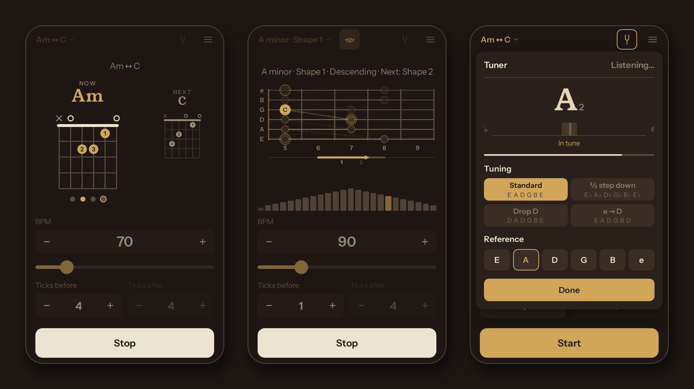
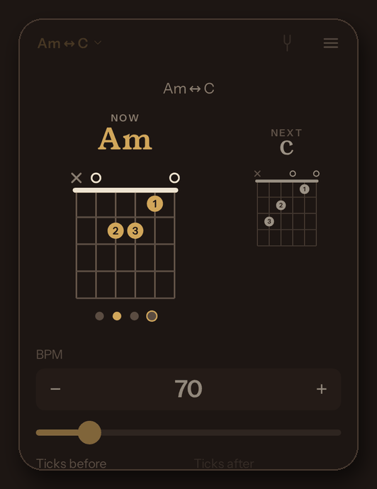
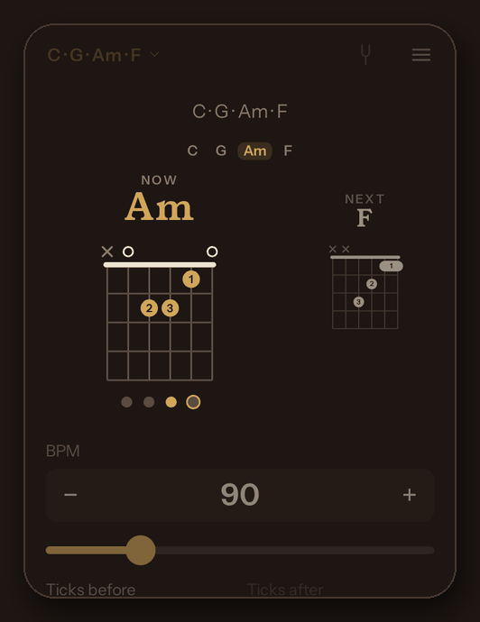
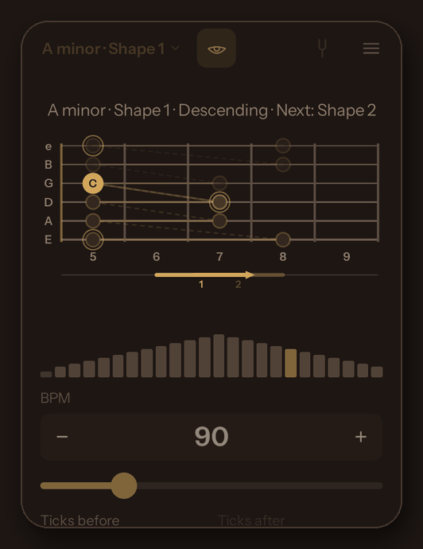
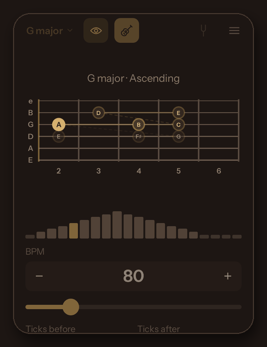
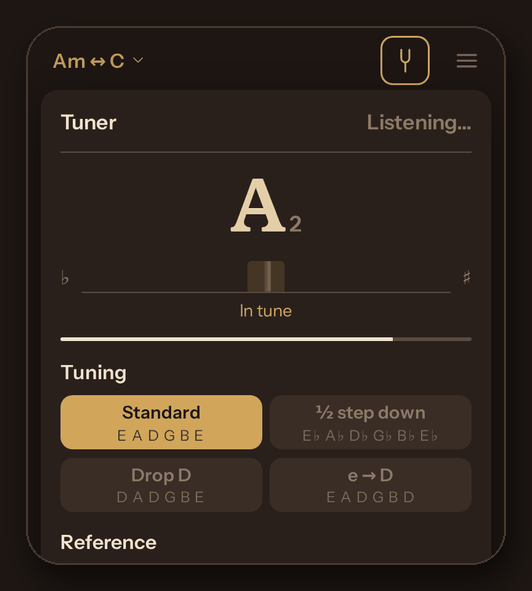
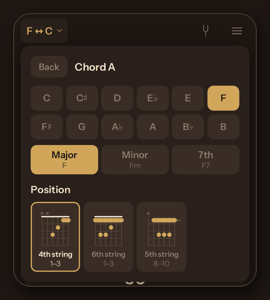
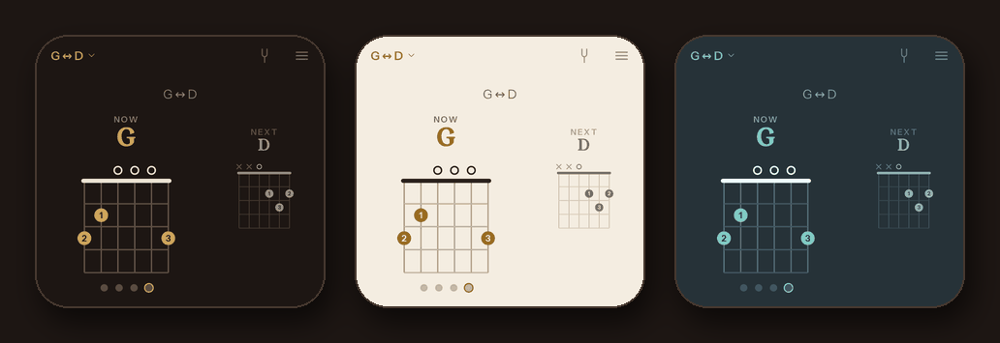

<div align="center">

# 🎸 Guitar Trainer

**Practise guitar with a metronome: chord changes, scales across the fretboard and pentatonic shapes, plus a tuner.**<br>
Free, no ads, no accounts. Works offline on your phone.

[](https://misan128.github.io/guitar-trainer/)

[](https://github.com/misan128/guitar-trainer/releases)
[](LICENSE)
[](https://buymeacoffee.com/misan128)



</div>

## What you can practise

Three exercises share the same metronome, BPM and ticks: pick one in the setup panel (the button at the top left). Practice keeps going until you stop it.

<table>
<tr>
<td width="290"></td>
<td>

### 🎵 Chord changes

Switch between two chords in time. The current chord is drawn large with its fingering, the next one waits beside it so you can prepare the move, and the dots count the ticks to the change.

- Any root, **major, minor or 7th**.
- Each chord in **several places on the neck**: open, or with its root on the 6th, 5th or 4th string (from full barres to the easy F, xx3211).
- **2, 4 or 8 ticks** per chord; an accented click and a soft strum on every change.

</td>
</tr>
<tr>
<td></td>
<td>

### 🔁 Progressions

Play a whole progression in any key: *I–V–vi–IV*, *I–IV–V*, *vi–IV–I–V*, *ii–V–I*, the *Andalusian cadence* or the *12-bar blues*.

- Each chord comes **where your hand is**: open when it can be, otherwise close to the chord before.
- A **strip** shows the whole progression and where you are.
- The ticks count bars; the strum only sounds when the chord changes.

</td>
</tr>
<tr>
<td></td>
<td>

### 🎯 Pentatonic shapes

The five minor pentatonic boxes as fixed fingerings, to build muscle memory: the whole shape up and back down, with the current note lit and the next move hinted.

- **Any minor key**, with open and octave variants where a shape fits twice.
- **Move along the neck:** each round slides to the next shape, up and down the neck, with a bar showing where you are and where you're going.

</td>
</tr>
<tr>
<td></td>
<td>

### 🪜 Scale walk

A random note from a major key, then up the octave and back down, one note per tick, on the fretboard and with the sound of a plucked string.

- **One or several keys**, in random order or around the circle of fifths.
- Every walk has **one fixed fingering** inside the fret zone you choose, and the notes you hear match the marked frets.
- **The eye** sets how much help you get: from every note named to only where to start.

</td>
</tr>
</table>

<details>
<summary><b>All the details of each exercise</b></summary>

#### Chord changes

- **Chords:** Chord A and Chord B, shown as tiles with their fingering (Am and C by default). Tap one to pick its root, its type (major, minor or 7th) and its position, all on one screen. Picking the other tile's chord swaps them.
- **Position:** every chord can be played in several places on the neck, shown as small diagrams: *open* where there is a standard open chord, and with its root on the *6th*, *5th* or *4th string* (the 4th-string ones are the small chords on the top strings, like the easy F, xx3211). The choice is remembered per chord; by default the lowest and easiest.
- **Ticks per chord:** 2, 4 or 8.
- **A round:** chord A for its ticks, then chord B, again and again. The prep ticks only come before the first chord. Each change gets an accented click and a soft strum of the new chord; how you strum is up to you.
- **On screen:** the current chord large, with its name in gold and its fingering (finger numbers in the dots, the barre as a bar, ○ open and × muted strings, and the starting fret when it is up the neck), and the next chord smaller beside it. Dots under the current chord count its ticks; the last one is ringed, the change comes after it. At rest, both chords are shown to study them.
- **Progression:** instead of two chords, choose a ready-made progression and its key. Each chord's position is chosen for you: open when there is one, otherwise close to the chord before, so the hand moves as little as possible. A strip above the chords shows the whole progression and where you are; the ticks count bars, and the strum only sounds when the chord changes.
- No eye here: both chords are always shown in full.

#### Pentatonic shapes

- Shape 1 has the root on the 6th string under the first finger; shapes 2–5 follow up the neck.
- **Key:** any of the 12 minor keys. The shape keeps its geometry and moves along the neck, with its notes spelled after the key signature.
- **Shape:** 1 to 5, each tile with a small diagram and its frets. The selected shape is shown on the fretboard before you start, with its roots marked.
- **Variant:** when a shape fits in two places, choose between them: *Open* or *Closed* for the five open-position ones (E minor shape 1, D minor 2, C minor 3, A minor 4, G minor 5), *Low* or *High* for two octaves of the same movable shape.
- **A round:** the complete six-string shape up (12 notes) and back down (11), then the same shape again straight away. The reference note and the prep ticks only come before the first round, and there are no wait ticks: the route never changes, so there is nothing to wait for.
- **Move along the neck:** each round moves to the next shape up the neck, and back down at the end, without stopping; the next shape is announced while you descend, and you slide along the 6th string into the next box. A bar under the fret numbers shows where you are on the neck and, on the way down, points to the next shape; on the last note the view slides there.

#### Scale walk

1. **Announce:** a random note from the round's key is shown and played once as a reference. Each key goes through all seven start notes before repeating one, and two rounds in a row never start on the same note.
2. **Prep:** a few metronome clicks to get ready.
3. **Walk:** 15 ticks, one note per tick: 8 notes up to the octave and 7 back down.
4. **Wait:** a few more clicks, then the next round starts.

- **Keys:** one or more of the 12 major keys (at least one stays selected; Clear goes back to C major), ordered by the circle of fifths. With several, rounds go in random order (each key once before any repeats) or in circle-of-fifths order; the key is shown with the round, and the wait ticks announce the next one.
- **Fretboard** (guitar beside the eye): shows each walk inside a neck zone you choose (first and last fret, at least 5 frets; standard tuning). The same key, start note and zone always give the same fingering. On by default, frets 2–6.
- **Aids** (the eye): each tap closes it one step: *all notes* named → only the *current note* named → the *shape* without names → only the *start* position, to play the rest from memory.

</details>

## 🎚️ Tuner, chord picker and themes

<table>
<tr>
<td width="50%"></td>
<td width="50%"></td>
</tr>
<tr>
<td>

**Tuner.** The tuning fork at the top right. Play a string: the note and a needle from flat to sharp, gold inside the in-tune band (±5 cents, A = 440 Hz). Four tunings (*Standard*, *½ step down*, *Drop D*, *e → D*), and reference strings to tune by ear. The microphone is only on while it is open; nothing is recorded or sent.

</td>
<td>

**Chord picker.** Tap a chord to choose its root, its type and where on the neck to play it, each position drawn as a small diagram, on one screen.

</td>
</tr>
</table>



**Three themes** in the menu: *Sepia*, warm and dark; *Maple*, light; *Steel*, blue-grey.

<details>
<summary><b>More about the tuner, settings and help</b></summary>

- **Tuner:** when the string fades, its note stays dimmed for a second and a half, then fades out. A thin bar shows how loud the microphone hears the guitar. The reference strings work without the microphone too.
- **BPM:** 30–300. **Ticks before / after:** 1–16 and 0–16 (the ticks after only apply to Scale walk).
- **Menu** (three lines, top right): the language (English, Spanish or Basque), the theme, **Help** and **About**.
- **Help:** a short guide shows where everything is on first use, and each panel (setup, chord picker, tuner, menu…) explains its own parts the first time you open it. **Help** shows the guide again, and **Show the tips again** brings the panels' tips back.
- The exercise, keys, shape and fretboard can only be changed while stopped. Settings are saved in the browser.

| Key | Action |
| --- | --- |
| `Space` | Start / stop |
| `↑` / `↓` | BPM ±1 |
| `Shift` + `↑` / `↓` | BPM ±5 |

</details>

## 📱 Install it on your phone

| iPhone | Android |
| --- | --- |
| Open the app in **Safari**, tap **Share → Add to Home Screen**, and open it from the icon. | Open the app in **Chrome**, tap **⋮ → Install app** (or **Add to Home screen**), and open it from the icon. |
| It plays even with the phone on silent (iOS 17 or later). | Sound follows the media volume. |

Either way it runs full screen, works offline after the first load, and keeps the screen on while you practise.

## 🛠️ For developers

A static web app: plain HTML, CSS and JavaScript (ES modules), no build step and no runtime dependencies.

```sh
npm start                            # serve it: http://localhost:8000/ (add ?debug for dev mode)
node --test                          # unit tests: Node 18+, no dependencies
npm install && npm run smoke:setup   # once, for the smoke tests (Playwright and Chromium)
npm run smoke                        # the main flows in a real browser
```

Opening `index.html` as a file does not work: browsers only load ES modules over HTTP(S). The unit tests check the music (fingerings, shapes, chords and progressions in every key, pitch detection) and that all languages have the same texts; the smoke tests run the app in Chromium. The spec is [docs/SPEC.md](docs/SPEC.md); what the tests cover, and a manual checklist for the phone, are in [docs/TESTING.md](docs/TESTING.md).

## License

[MIT](LICENSE) · Made by [Michael Sandoval](https://github.com/misan128) · If it helps you, [a coffee (or a beer)](https://buymeacoffee.com/misan128) is always welcome ☕️
